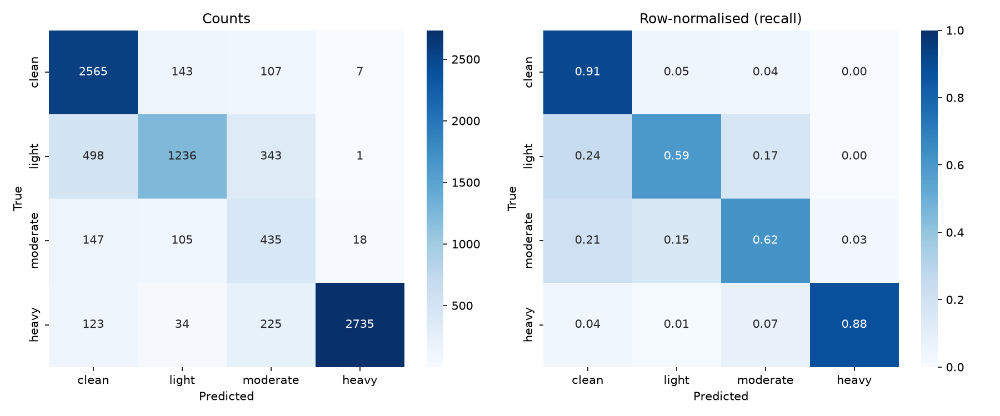
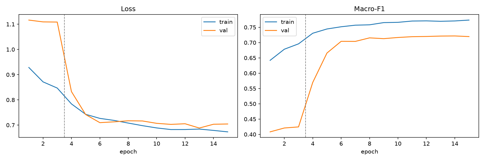
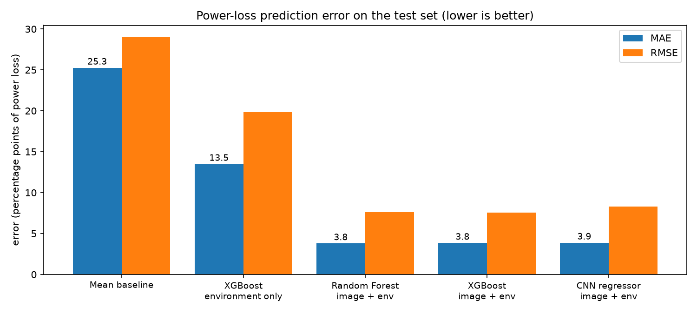
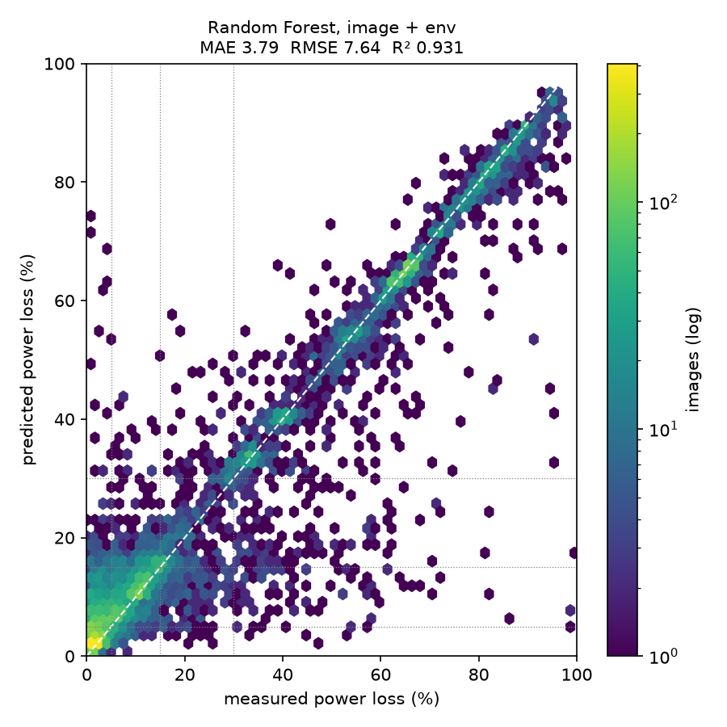
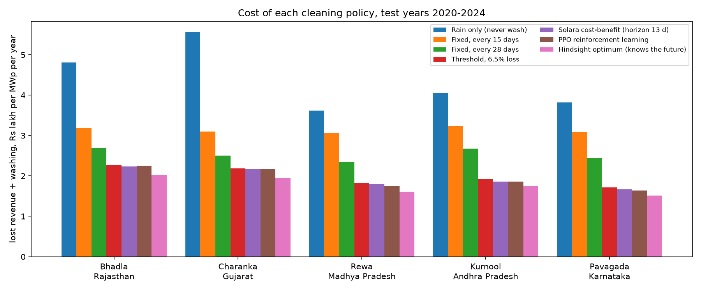
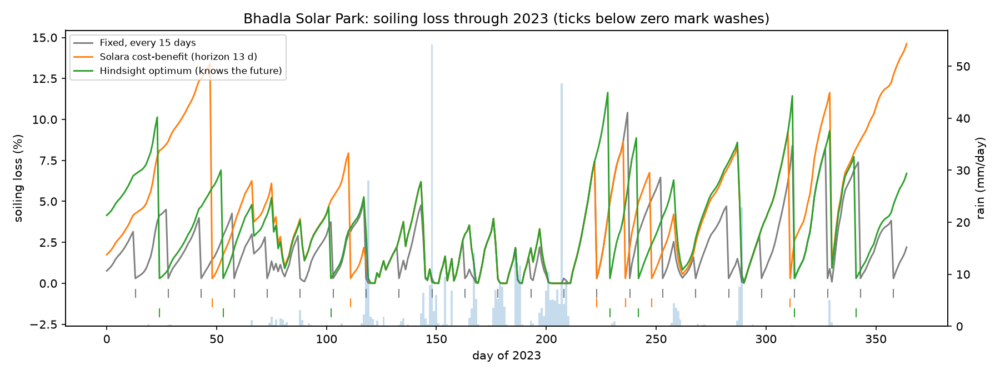

# Solara

**AI-based solar panel soiling detection, power-loss prediction and intelligent cleaning scheduling.**

Dust, pollen and bird droppings on photovoltaic panels cut their output, sometimes by more than 40% in dusty regions. Most sites still clean on a fixed calendar, which wastes water when panels are clean and loses energy when they are dirty. Solara replaces the calendar with three connected models:

| Module | What it does | Status |
|---|---|---|
| 1. Detect | CNN that classifies a panel image by soiling severity | Done |
| 2. Predict | Regression of the exact power loss (%) caused by the soiling | Done |
| 3. Schedule | Cost-benefit / learned cleaning schedule vs. fixed-interval baseline, at five Indian solar parks | Done |

The project website (`website/`) is a single page with a real-time 3D solar panel lit by a sun that follows your cursor.

---

## Module 1: soiling detection

### Data: DeepSolarEye

[DeepSolarEye](https://deep-solar-eye.github.io/) (Mehta et al., WACV 2018) has 45,754 RGB images (192×192) of one solar panel photographed over several weeks while dust settled and was cleaned away. Each filename encodes the timestamp, the **power loss** relative to a clean reference panel, and the **irradiance**:

```
solar_Fri_Jun_16_10__0__11_2017_L_0.906153208302_I_0.0058574424375.jpg
```

The dataset has no soiling-*type* labels, so Solara classifies soiling **severity** by binning the measured power loss:

| Class | Power loss |
|---|---|
| clean | < 5% |
| light | 5 – 15% |
| moderate | 15 – 30% |
| heavy | > 30% |

Frames taken in very dim light (normalised irradiance < 0.05) have unreliable loss labels and are excluded.

**Split.** By default the usable images are split at random, stratified by class: 20% for testing, and of the remaining 80%, 10% for validation (used to pick the best epoch), giving 72 / 8 / 20.

A stricter option is in `config.py`: `SPLIT_MODE = "day"` keeps whole days together, so near-identical frames taken minutes apart never appear in both train and test. Expect lower but more conservative scores with it.

### Model

- **Backbone:** MobileNetV2 pre-trained on ImageNet (light enough for edge devices such as a Jetson Nano or Raspberry Pi).
- **Head:** Dropout → Linear(1280→256) → ReLU → Dropout → Linear(256→4).
- **Training:** 3 epochs with the backbone frozen (head only, lr 1e-3), then 12 epochs fine-tuning the whole network (lr 1e-4, cosine decay), AdamW, label smoothing 0.05, mixed precision.
- **Class imbalance:** weighted random sampling so each severity is seen equally often.
- **Augmentation:** rotation, horizontal flip, brightness/contrast/saturation jitter, Gaussian noise (robustness to lighting and camera angle).
- **Model selection:** the checkpoint with the best validation macro-F1.

### Results

<!-- RESULTS:START -->
Test set: 8,722 held-out images (stratified random 20% split).

| Metric | Value |
|---|---|
| Accuracy | **79.9%** |
| Macro precision | 0.742 |
| Macro recall | 0.750 |
| Macro F1 | **0.733** |
| Majority-class baseline accuracy | 35.7% |

| Class | Precision | Recall | F1 | Test images |
|---|---|---|---|---|
| clean | 0.77 | 0.91 | 0.83 | 2,822 |
| light | 0.81 | 0.59 | 0.69 | 2,078 |
| moderate | 0.39 | 0.62 | 0.48 | 705 |
| heavy | 0.99 | 0.88 | 0.93 | 3,117 |




**Reading the results.** Clean and heavy soiling are recognised reliably (F1 0.83 and 0.93). The middle classes are harder: their power-loss ranges are narrow (5 to 15% and 15 to 30%), so images near a boundary look alike, and *moderate* is the rarest class (8% of images). Most errors fall in a neighbouring class rather than a distant one. Validation F1 levels off after about 10 epochs with no sign of overfitting.

Possible next steps: predict the loss percentage directly (Module 2) and bin it, higher input resolution, or a larger backbone (EfficientNet, ResNet-50).
<!-- RESULTS:END -->

### Run it yourself

```bash
python -m venv .venv
# Windows: .venv\Scripts\activate    macOS/Linux: source .venv/bin/activate
pip install torch torchvision --index-url https://download.pytorch.org/whl/cu124
pip install -r requirements.txt

python -m module1_detection.prepare_data --download   # download, unzip, index, split
python -m module1_detection.train                     # fine-tune MobileNetV2 (GPU recommended)
python -m module1_detection.evaluate                  # metrics + figures in module1_detection/outputs/
python -m module1_detection.export_site                # publish results to the website
python -m module1_detection.predict path/to/panel.jpg # classify your own image (trained weights are included)
```

Settings (class thresholds, irradiance cut-off, split mode, epochs, learning rates) live in [`module1_detection/config.py`](module1_detection/config.py).

## Module 2: power-loss prediction

Module 2 predicts the **percentage of power lost** to soiling, a continuous number, instead of a class. Inputs are the panel photograph plus the environmental data DeepSolarEye records for every image: **irradiance** and **time of day** (encoded as sine and cosine so 23:59 sits next to 00:00). It uses the same images and the same train/val/test split as Module 1, so the scores are directly comparable.

### Models

| Model | Inputs | How |
|---|---|---|
| Mean baseline | none | always predicts the training mean |
| XGBoost, environment only | irradiance, time | shows what can be predicted *without* looking at the panel |
| Random Forest | image + env | 1280-d Module 1 embedding, reduced to 64 PCA components, plus environment |
| XGBoost | image + env | same features; early stopping on validation MAE |
| CNN regressor | image + env | MobileNetV2 initialised from the Module 1 classifier, image features fused with a small environment branch, sigmoid output; Smooth L1 loss; frozen-backbone phase then full fine-tune |

### Results

Test set: 8,722 images. Errors are in **percentage points** of power loss.

| Model | MAE | RMSE | R² | Binned accuracy | Binned macro F1 |
|---|---|---|---|---|---|
| Mean baseline | 25.25 | 29.00 | -0.000 | 8.1% | 0.037 |
| XGBoost, environment only | 13.49 | 19.85 | 0.532 | 51.0% | 0.457 |
| Random Forest, image + env | 3.79 | 7.64 | 0.931 | 75.7% | 0.695 |
| XGBoost, image + env | 3.85 | 7.54 | 0.932 | 76.9% | 0.703 |
| CNN regressor, image + env | 3.87 | 8.29 | 0.918 | 80.8% | 0.743 |

*Binned* means the predicted loss is cut at Module 1's thresholds (5 / 15 / 30%) and scored as a four-class classifier. For comparison, the Module 1 classifier reaches 79.9% accuracy and 0.733 macro F1.

MAE by soiling severity (percentage points):

| Model | clean | light | moderate | heavy |
|---|---|---|---|---|
| XGBoost, environment only | 11.9 | 9.7 | 9.8 | 18.3 |
| Random Forest, image + env | 3.5 | 2.9 | 5.7 | 4.2 |
| XGBoost, image + env | 3.2 | 3.1 | 6.1 | 4.4 |
| CNN regressor, image + env | 2.2 | 3.1 | 7.4 | 5.0 |




**Reading the results.**
- The photograph carries the signal. The environment-only model's error (13.5) is about 3.5 times higher than any image model's.
- The three image models are close: about 3.8 to 3.9 points MAE and R² of about 0.92 to 0.93. Random Forest has the lowest MAE, XGBoost the lowest RMSE (fewer large misses) and the CNN the lowest error on clean panels.
- Predicting the number and then binning it classifies soiling **better than the Module 1 classifier**: the CNN regressor reaches 80.8% accuracy and 0.743 macro F1. The regression target keeps the ordering between classes that a plain classifier throws away.
- *Moderate* soiling (15–30%) remains the hardest range for every model.

### Run it

```bash
python -m module2_powerloss.train_cnn      # CNN regressor (starts from the Module 1 weights)
python -m module2_powerloss.features       # cache Module 1 embeddings for the tree models
python -m module2_powerloss.train_trees    # baselines, Random Forest, XGBoost
python -m module2_powerloss.evaluate       # compare all models, write figures
python -m module2_powerloss.export_site    # publish to the website
python -m module2_powerloss.predict panel.jpg --irradiance 0.45 --time 12:30
```

## Module 3: intelligent cleaning scheduling (India)

Module 3 decides **each morning whether to wash the panels**. It is tested on five utility-scale Indian solar parks with 20 years of real daily weather.

### Sites and data

| Park | Rain (mm/yr) | Dry-day soiling (%/day) | 15-day schedule (₹/MW/yr) | Solara (₹/MW/yr) | Saving | Solara washes/yr | Next wash (as of 31 Dec 2024) |
|---|---|---|---|---|---|---|---|
| Bhadla Solar Park, Rajasthan | 377 | 0.40 | ₹318,424 | ₹223,438 | 29.8% | 8.2 | 2025-01-01 |
| Charanka Solar Park, Gujarat | 701 | 0.38 | ₹309,993 | ₹216,794 | 30.1% | 7.8 | 2025-01-11 |
| Rewa Ultra Mega Solar, Madhya Pradesh | 1,051 | 0.48 | ₹306,291 | ₹179,879 | 41.3% | 5.9 | 2025-01-18 |
| Kurnool Ultra Mega Solar Park, Andhra Pradesh | 726 | 0.53 | ₹323,532 | ₹186,057 | 42.5% | 6.4 | 2025-01-15 |
| Pavagada Solar Park, Karnataka | 754 | 0.45 | ₹308,512 | ₹166,681 | 46.0% | 6.1 | 2025-01-17 |

- **Weather:** [NASA POWER](https://power.larc.nasa.gov/) daily irradiance, rain, temperature, humidity, wind and aerosol optical depth (AOD) for each park, 2005 to 2024 (`weather.py`). Policies are **tuned on 2005 to 2019** and **tested on 2020 to 2024**.
- **Soiling physics:** on dry days dust adds a loss proportional to that day's AOD, scaled so the average across the five parks is **0.40 %/day**, the middle of Indian field measurements: Delhi 0.3 to 0.6 %/day ([Renewable Watch](https://renewablewatch.in/2018/12/22/soiling-analysis/)), Gandhinagar 0.37 ± 0.09 %/day ([pv magazine India](https://www.pv-magazine-india.com/?p=4339)), north India up to 0.47 %/day ([PMC](https://www.ncbi.nlm.nih.gov/pmc/articles/PMC12658225/)). Rain of 5 mm or more washes off 90% of the dust, and 1 to 5 mm washes off 40%.
- **Energy:** daily irradiance × 1 MWp × performance ratio 0.8.
- **Money:** lost energy valued at **₹2.6/kWh** (recent SECI auction level). One manual wash of 1 MWp costs **₹9,500**: ₹8,000 of labour plus 15,000 L of water at ₹0.10/L. Indian reports give 7,000 to 24,000 L per MW per wash and ₹1 to 7.5 lakh per MW per year for cleaning ([pv magazine India](https://www.pv-magazine-india.com/2018/10/02/study-high-risk-through-water-use-in-solar-sector), [Mercom](https://mercomindia.com/robotic-cleaning-solar-modules-gaining-traction-india)).

### The sensor: Modules 1 and 2 in the loop

The scheduler never sees the true soiling. Each day the camera's midday photos go through **Module 2's CNN** and are averaged. The simulated reading carries Module 2's **measured** daily-average error at that soiling level: on nearly clean panels a bias of about +2.4 points with 1.3 points of day-to-day spread, growing at heavier soiling. The operator re-zeroes the reading the morning after each wash, when the panels are known to be clean, and smooths it with an exponential average that also learns the site's soiling rate.

### Policies

| Policy | Rule |
|---|---|
| Fixed interval | wash every N days; 15 is common practice, and N is also tuned per site |
| Threshold | wash when the estimated loss passes θ % (θ tuned per site) |
| **Solara cost-benefit** | wash when (estimated loss − residual) × expected daily energy × tariff × H days is greater than the cost of a wash; H is shortened if the 3-day forecast shows ≥5 mm of rain, which will clean the panels for free |
| PPO (An, 2025) | reinforcement-learning agent (stable-baselines3) that sees the same inputs; reward = −(lost revenue + washing cost); trained on 2005 to 2019 at all five parks |
| Hindsight optimum | dynamic programming with the true loss and all future weather known. No real policy can beat it; it measures how much room is left |

### Results (test years 2020 to 2024, average of five parks, per MWp per year, 5 noise seeds)

| Policy | Washes | Water (kL) | Energy lost (MWh) | Total cost | vs 15-day | Above optimum |
|---|---|---|---|---|---|---|
| Rain only (never wash) | 0.0 | 0 | 168.1 | ₹437,012 | +39.5% | 146.9% |
| Fixed, every 15 days (common practice) | 24.2 | 363 | 32.1 | ₹313,350 | – | 77.0% |
| Fixed interval, tuned per site | 9.8 | 148 | 61.5 | ₹253,317 | −19.2% | 43.1% |
| Threshold on Module 2 estimate, tuned | 7.6 | 114 | 48.5 | ₹198,184 | −36.8% | 12.0% |
| **Solara cost-benefit + rain forecast** | 6.9 | 103 | 49.7 | ₹194,570 | −37.9% | 9.9% |
| PPO reinforcement learning | 5.6 | 85 | 53.9 | ₹193,579 | −38.3% | 9.4% |
| Hindsight optimum (knows the future) | 6.6 | 98 | 44.1 | ₹177,002 | −43.5% | 0.0% |




**Reading the results.**
- Washing on the panel's actual condition, rather than the calendar, cuts the yearly cost of soiling by **38%** compared with the common 15-day routine. That is about **₹118,780 per MW per year** with **17 fewer washes** and about **260 kL less water** per MW per year. Even the best tuned calendar saves only 19%.
- Solara ends up **within 10% of the hindsight optimum**. PPO performs about the same (9.4% above the optimum), and a tuned threshold rule comes close (12%). Most of the gain comes from using a condition sensor (Modules 1 and 2) at all. The cost-benefit rule adds a little on top, with the advantage that it is transparent: every wash comes with a rupee justification.
- The remaining gap is mostly due to the sensor. Module 2 under-reads moderate soiling (5 to 15%), so washes sometimes come a few days late. A better Module 2 in that range would directly improve scheduling.
- **Sensitivity:** ₹4,750 per wash: 22% saving · ₹9,500 per wash: 38% saving · ₹19,000 per wash: 55% saving. The more a wash costs, the more it pays to wash only when needed.

### Run it

```bash
python -m module3_scheduling.weather       # download NASA POWER weather for the five parks
python -m module3_scheduling.rl            # train the PPO scheduler (about 10 min, CPU)
python -m module3_scheduling.evaluate      # tune on 2005-2019, test on 2020-2024, figures
python -m module3_scheduling.export_site   # publish to the website
```

All assumptions (tariff, wash cost, water, soiling rate, rain thresholds, sites) are in [`module3_scheduling/config.py`](module3_scheduling/config.py).

---

## Website

```bash
python -m http.server 8000 --directory website
# open http://localhost:8000
```

Built with three.js. The solar panel is generated procedurally: 60 monocrystalline cells with busbars and fingers, white backsheet, anodised aluminium frame and anti-reflective glass. The **Detect** tab lets you dust the panel at each severity level.

## Repository layout

```
module1_detection/   data preparation, model, training, evaluation, prediction
module2_powerloss/   power-loss regression: CNN, Random Forest, XGBoost, baselines
module3_scheduling/  cleaning scheduler: soiling simulator, policies, PPO, hindsight optimum
  outputs/           metrics.json, confusion matrix, training curves, sample predictions
website/             project website (three.js)
data/                dataset (downloaded, not committed)
```

## References

1. S. Mehta, A. P. Azad, S. A. Chemmengath, V. Raykar, S. Kalyanaraman, "DeepSolarEye: Power Loss Prediction and Weakly Supervised Soiling Localization via Fully Convolutional Networks for Solar Panels," *WACV*, 2018.
2. M. Sandler, A. Howard, M. Zhu, A. Zhmoginov, L.-C. Chen, "MobileNetV2: Inverted Residuals and Linear Bottlenecks," *CVPR*, 2018.
3. H. An, "Reinforcement learning-based dynamic cleaning scheduling framework for solar energy system," Kumoh National Institute of Technology, 2025.
4. S. Manoj and M. Dai, "Neural Network-Based Optimization of PV Output Power Through Adaptive Cleaning Schedules," *NHSJS*, 2025.
5. NASA Langley Research Center, POWER Project, daily data (power.larc.nasa.gov).

## Author

Ritu Ramesh, B.Tech Artificial Intelligence and Data Science, Amrita Vishwa Vidyapeetham, with Dr. Gargi.

Code: MIT licence. The DeepSolarEye dataset belongs to its authors and is used under CC BY-NC-SA. It is not redistributed here.
